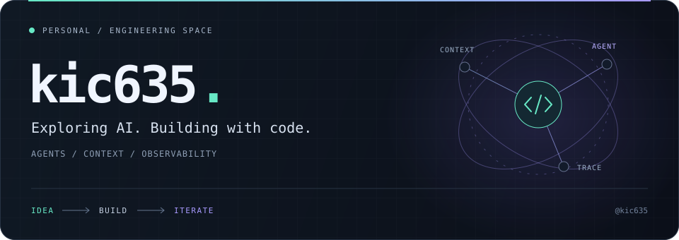

  

  <a href="https://github.com/kic635?tab=repositories"><b>浏览全部仓库 ↗</b></a>
  &nbsp; · &nbsp;
  <a href="https://github.com/kic635?tab=stars">我的 Stars ↗</a>

### / 关于我

你好，我是 **kic635**。探索 AI 应用开发，关注 **Agent 协作、检索增强与跨会话记忆**，也关心如何看清应用的真实执行过程。

从 Python 后端到 TypeScript 界面，把想法写成能运行的东西，在实践中不断迭代。

### / 技术坐标

| 方向 | 关注的内容 |
| :--- | :--- |
| **Agent & Context** | LangChain · LangGraph · RAG · 跨会话记忆 |
| **Observability** | 执行追踪 · Langfuse · AI Vision |
| **Backend** | Python · FastAPI |
| **Frontend** | TypeScript · React · Vite |

 

  Explore → Build → Learn → Repeat

