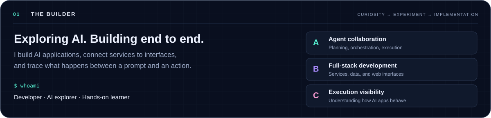
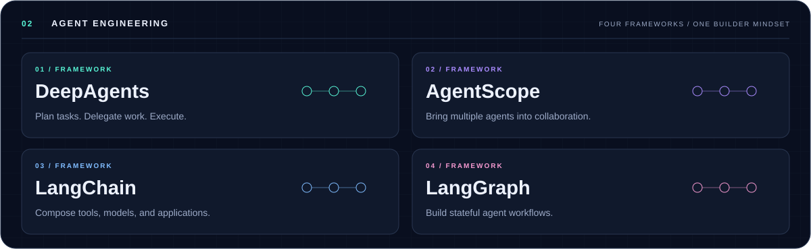
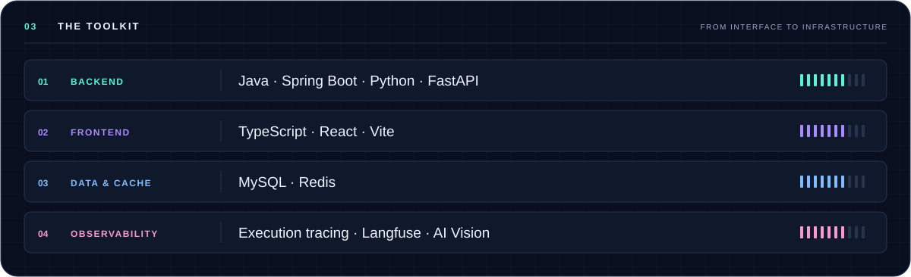
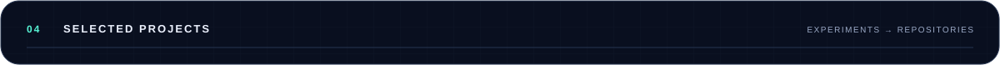
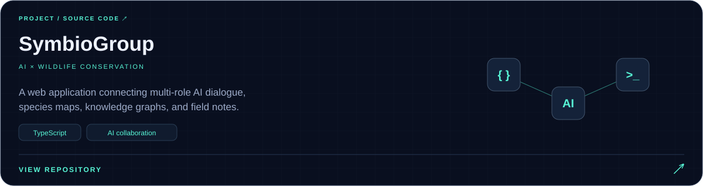
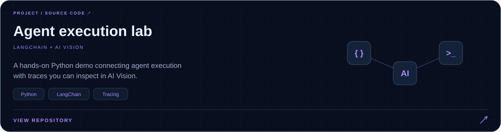
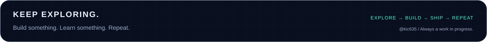

<!-- Profile designed for GitHub Markdown: local SVG artwork, no scripts or external stats services. -->

  

  <a href="#about"><b>ABOUT</b></a> &nbsp; / &nbsp;
  <a href="#agents"><b>AGENTS</b></a> &nbsp; / &nbsp;
  <a href="#stack"><b>STACK</b></a> &nbsp; / &nbsp;
  <a href="#projects"><b>PROJECTS</b></a> &nbsp; / &nbsp;
  <a href="https://github.com/kic635?tab=repositories"><b>ALL REPOSITORIES ↗</b></a>

  

  

  

  

  

  

  <a href="https://github.com/kic635?tab=repositories"><b>More experiments ↗</b></a>
  &nbsp; · &nbsp;
  <a href="https://github.com/kic635?tab=stars"><b>Things I find interesting ↗</b></a>

  

