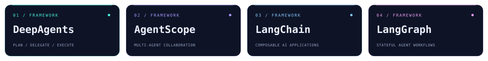

  

  <a href="https://github.com/kic635?tab=repositories"><b>Explore repositories ↗</b></a>
  &nbsp; · &nbsp;
  <a href="https://github.com/kic635?tab=stars">My stars ↗</a>

### `01` / Behind the code

Hi, I'm **kic635**. I explore AI application development, with a focus on **AI agents, multi-agent collaboration, and practical AI engineering**.

I build backend services with Java, Spring Boot, Python, and FastAPI, using MySQL for data storage and Redis for caching. I also work with TypeScript and React to connect these services to web interfaces. I'm also interested in tracing how AI applications actually behave—from the context they retrieve to the actions they take.

### `02` / Agent engineering

  

### `03` / The toolkit

| Area | Tools & interests |
| :--- | :--- |
| **Agent Frameworks** | DeepAgents · AgentScope · LangChain · LangGraph |
| **Observability** | Execution tracing · Langfuse · AI Vision |
| **Backend** | Java · Spring Boot · Python · FastAPI |
| **Databases & Cache** | MySQL · Redis |
| **Frontend** | TypeScript · React · Vite |

 

  ⚡ Explore → Build → Ship → Repeat

